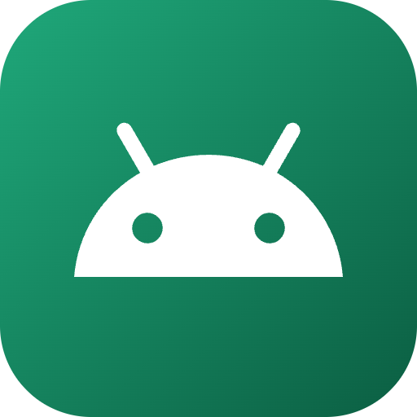
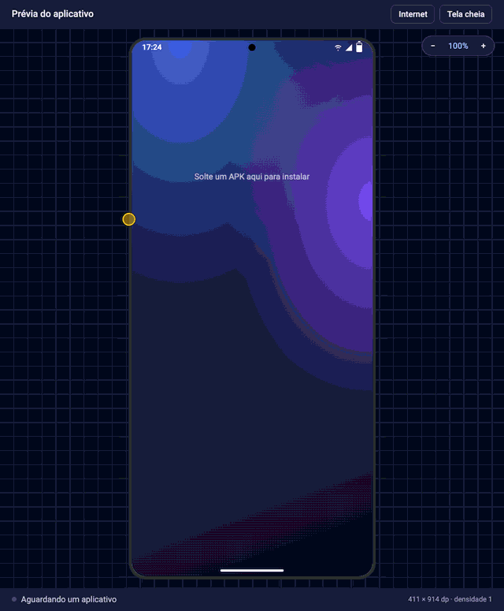
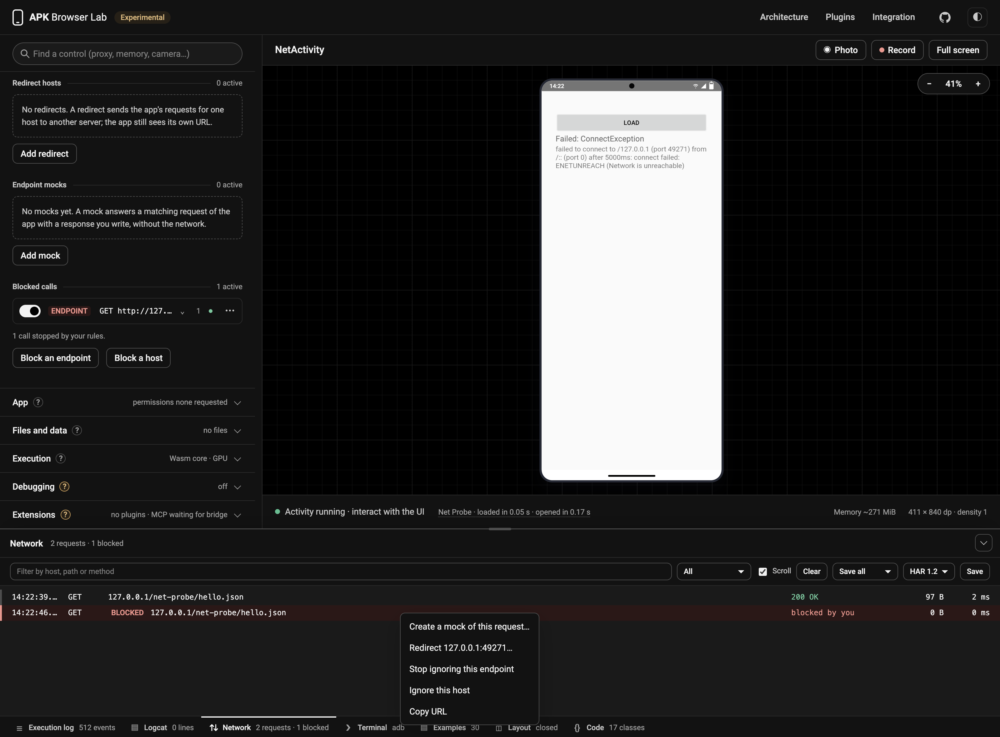
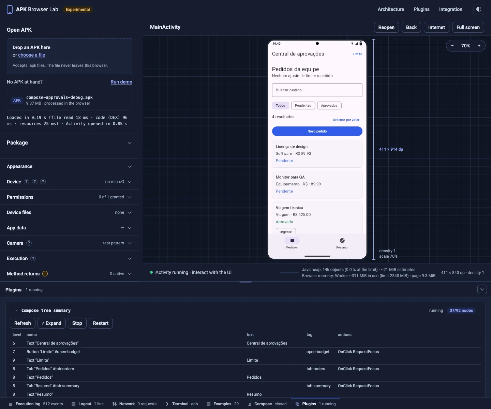
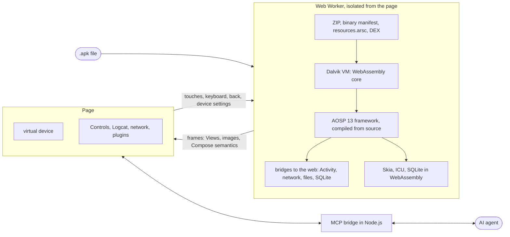

# APK Browser Lab

**Run an Android APK inside a browser tab.** No emulator, nothing to install, and the file is never sent anywhere: the `.apk` is opened in the page itself, its code runs in a virtual machine built for the web, and the app's screen appears right there, responding to your touch.

### [▶ Open the lab](https://madmax-dev-br.github.io/apk-browser-lab-site/)

[](https://madmax-dev-br.github.io/apk-browser-lab-site/)

<sub>A Jetpack Compose (Material 3) app running in the page: real touches, real keyboard, nothing pre-recorded by the app. The yellow dot marks the pointer.</sub>

## Why this is interesting

- **The APK runs as is.** It is not recompiled and does not need the source code. The DEX bytecode in the file is what executes.
- **The Android underneath is the original.** The framework is the AOSP 13 code compiled from source; Skia, ICU and SQLite run in WebAssembly. The goal is the behavior of a device, not an imitation.
- **Everything happens in your browser.** There is no execution server. The file never leaves your machine.
- **When something is missing, the lab tells you what.** An Android API that does not exist here yet fails with its exact name, instead of pretending it worked.
- **You can automate it.** JavaScript plugins read the app from the inside, and an AI agent (Claude Code, Cursor, Codex) drives the page over MCP, including with the `adb` commands you already use with an emulator.

## Try it in one minute

1. Open **<https://madmax-dev-br.github.io/apk-browser-lab-site/>** in a recent browser.
2. Drag an `.apk` onto the page (up to 1 GiB; `.aab` bundles and `.apks` / `.xapk` / `.apkm` sets also open).
3. The app is installed on the virtual device's home screen and opens. Tap, type, scroll, go back.

The site does not ship ready-made APKs: you use your own. The apps in the images on this page are the project's own sample apps, made to test the lab.


## What already runs

UIs in Jetpack Compose and in Views/XML, Fragments, navigation between screens and between Activities, long lists with images, forms, dialogs, SharedPreferences, SQLite, networking over `fetch`, threads, `Handler`/`Looper` and coroutines.


<sub>The project's sample apps: Compose with state, Navigation Compose, Views with Fragments and a heavy list with images.</sub>

### An app the size of a production app

[](https://madmax-dev-br.github.io/apk-browser-lab-site/)

<sub>The "App grande" ("Large app") example in the page, in real time: real touches and scrolls, from the file to the last tab.</sub>

The project's largest example is the size of a production Compose app: **17 DEX files with about 250 thousand methods**, with Compose and Material 3, Navigation, Room, Koin, kotlinx.serialization, DataStore, WorkManager, Coil, Lottie and classic Views. At startup, the app's own code builds a Koin graph of 1.7 thousand definitions, reads JSON catalogs and creates a Room database with 6.6 thousand rows. After that, everything keeps running at the same time:

- **Início** (Home): carousel, chips, stories and a list with 20 item types.
- **Feed**: 1500 posts with photo collages and reactions.
- **Grade** (Grid): 3000 photos in a staggered grid.
- **Chat**: 3600 messages in reverse order.
- **Painel** (Dashboard): animated charts drawn with `Canvas`.
- **Views**: `RecyclerView` with nine row types, `ViewPager2` and `DiffUtil` updating every second.
- **Diagnóstico** (Diagnostics): the time of each startup step and the app's memory.

The strip at the top of the screen belongs to the app: frames per second, dropped frames and the Java heap. Below the device, the page shows what the lab is using. All the content (texts, photos, fonts and animations) is generated by a script, with nobody's data.

## What you can do with it

### A device you control

Screen size, orientation, light or dark theme, language and region, time zone, font scale, battery and network (online, mobile data, offline). The app's runtime permissions are yours to grant or deny. **Photo** and **Record** save a picture or a video of the screen. An **adb terminal** in the page itself accepts the commands you use with an emulator, and a deep link opened with `am start` goes to the installed app that handles it.

### See the app from the inside

- Live **Logcat** and **network log**, with every request the app makes.
- **Endpoint mocks**: make `/v1/perfil` return whatever you want, without touching the server.
- **Blocked calls**: stop an endpoint or a whole host. The call is not made at all, and the app gets at once the error of a connection that cannot be made. A block wins over a mock.
- **Host redirects**: point the app's API at your `localhost`.
- **App data**: SharedPreferences and SQLite databases, to read and edit.
- **Layout bounds** and the **Compose tree**, with the CompositionLocals of each composable.
- **Code**: the APK's classes as smali and as decompiled Java, with a Java debugger (breakpoints, stepping, variables).
- **Diagnostics** when something stops: the cause, the Java stack and the APIs that were missing.



<sub>Right-click a request in the Network panel to ignore its endpoint or its host. The rule appears under Controls › Network › Blocked calls, and the next call fails at once, marked "blocked by you".</sub>

Everything you set in the Controls (device, mocks, blocked calls, method returns, ignored Activities, permissions and plugins) is saved with one **Export** and brought back with one **Import**. Plugins in a file are applied only after you confirm them, and the file never carries app data, account sessions, cookies or credentials.

### Plugins

Small JavaScript scripts that run next to the app and read the screen, the Compose tree, the ViewModels and static state, take screenshots of a component, scroll lists and draw over the device. There are [ready-to-copy examples](https://madmax-dev-br.github.io/apk-browser-lab-site/plugins.html#exemplos).



### AI agents, over MCP

A small Node.js bridge connects the open page to an MCP client. The agent takes screenshots, taps, types, reads Logcat and the network, sets mocks and blocked calls, exports and imports the configuration, reads the code and uses the debugger, installs and opens apps, records the screen to video, and accepts `adb` command lines:

```sh
adb install -r app-debug.apk
adb shell am start -W -n com.example.app/.MainActivity
adb shell input tap 200 400 && adb shell input text hello%sworld
adb exec-out screencap -p > screen.png
adb exec-out uiautomator dump /dev/tty
adb logcat -d *:E | grep -i timeout
```

It is not adb: it is an interpreter that does in the page what each command does on a device, and that refuses by name what the page cannot reach. The page shows the command to start the bridge and the address for the agent under **Controls › Extensions › MCP**, and connects to the bridge by itself while it runs (no token). Details in [MCP: the agent using the page](https://madmax-dev-br.github.io/apk-browser-lab-site/plugins.html#mcp).

### Embed in another page

The virtual device also works as a player inside an `iframe`, driven by messages. See the [integration page](https://madmax-dev-br.github.io/apk-browser-lab-site/player/example.html).

## How it works



- The APK is read in a **Web Worker**: ZIP, manifest, resources and DEX, without going through the page.
- The bytecode runs in a **Dalvik VM** whose core is WebAssembly. Threads, clock, garbage collector and memory limit are modeled.
- The `android.*` classes come from **AOSP 13 compiled from source**, with the adaptations recorded. The boundaries with the world (window, network, files, database) are bridges to web APIs.
- **Compose** draws with the real Skia, in WebAssembly, and receives touches as real `MotionEvent` events.
- The page only shows the frames and sends the input. What the app does is decided by the app's code.

The full step-by-step explanation is on the [Architecture](https://madmax-dev-br.github.io/apk-browser-lab-site/arquitetura.html) page.

## Limits, without embellishment

This is not an Android emulator. There is no kernel, no hardware and no Play Store.

- **Native libraries** (`.so`) only run when there is a WebAssembly version compiled from public source. The rest become an explicit failure. The app's protection libraries are never replaced or bypassed.
- **Google services**: by default the device has none. A device option installs microG, the open-source reimplementation, built from its source. Its online features (device registration, account login, push, attestation) stay off until you turn each one on; they run microG's own code, and no result is ever made up by the lab.
- **Large apps** exercise much more of Android than the examples. Each one reveals APIs that are still missing, and the lab shows which.
- **Performance** is lower than a device's. It is worked on with measurements, not impressions. In the latest round (headless Chrome, default engine and GPU renderer, medians), 50 short coroutine delays started by a tap went from 456 to 276 ms, and the Views tab of the large example, while scrolling, from 52 to 58 frames per second, with the 95th percentile frame from 30 to 18 ms. Compose scrolling of the examples stayed where it was, at about 58 frames per second.
- The badge at the top of the page is honest: **Experimental**.

## Privacy

The APK is read and executed in your browser. Nothing is sent to a lab server, because there is none. The app's network traffic goes out through the browser itself, or through the optional relay you run on your own computer; you can limit it to a list of hosts, take the device offline or block single calls. The lab itself has no analytics, no crash reports and no update checks. The apps you open are stored in this browser (IndexedDB), to reopen from the icon, and you can remove them.

## Links

| | |
|---|---|
| [Lab](https://madmax-dev-br.github.io/apk-browser-lab-site/) | Open and run an APK |
| [Architecture](https://madmax-dev-br.github.io/apk-browser-lab-site/arquitetura.html) | From the file to the screen, inside |
| [Plugins](https://madmax-dev-br.github.io/apk-browser-lab-site/plugins.html) | The `lab.*` API and ready-made examples |
| [MCP](https://madmax-dev-br.github.io/apk-browser-lab-site/plugins.html#mcp) | Connect an AI agent, `adb` commands, record the screen |
| [Integration](https://madmax-dev-br.github.io/apk-browser-lab-site/player/example.html) | The virtual device inside your page |
| [Third-party licenses](THIRD_PARTY.md) | Notices and licenses of libraries included in the build (texts in [`licenses/`](licenses)) |

## About this repository

This repository holds the published build, which is what GitHub Pages serves. Found an app that does not open, or a missing API? [Open an issue](https://github.com/madmax-dev-br/apk-browser-lab-site/issues) with the text from **Copy diagnostics** on the page. It includes the cause and the APIs that were missing, and it is what helps most to close the gap.

## License

APK Browser Lab is free software under the [MIT License](LICENSE): use it, copy it, change it, share it or sell it, for any purpose, keeping the copyright notice. The MIT License covers this project's own code. The third-party components in the build (the AOSP framework, libcore, Skia, ICU, SQLite, fonts, microG and the others) keep their own licenses, listed in [`THIRD_PARTY.md`](THIRD_PARTY.md).
