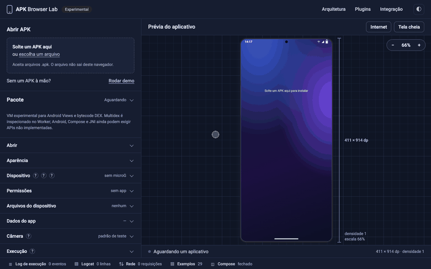
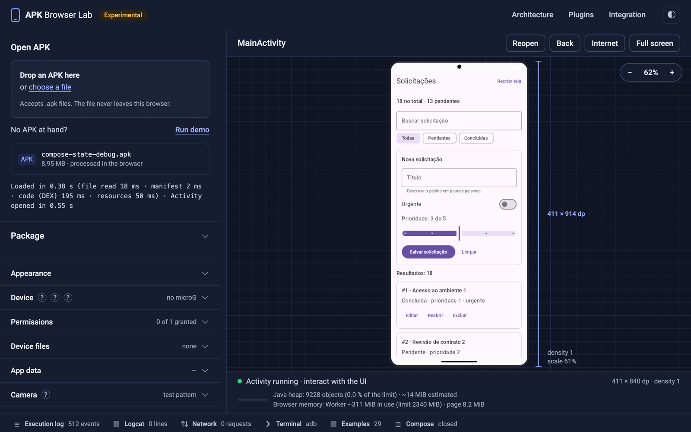
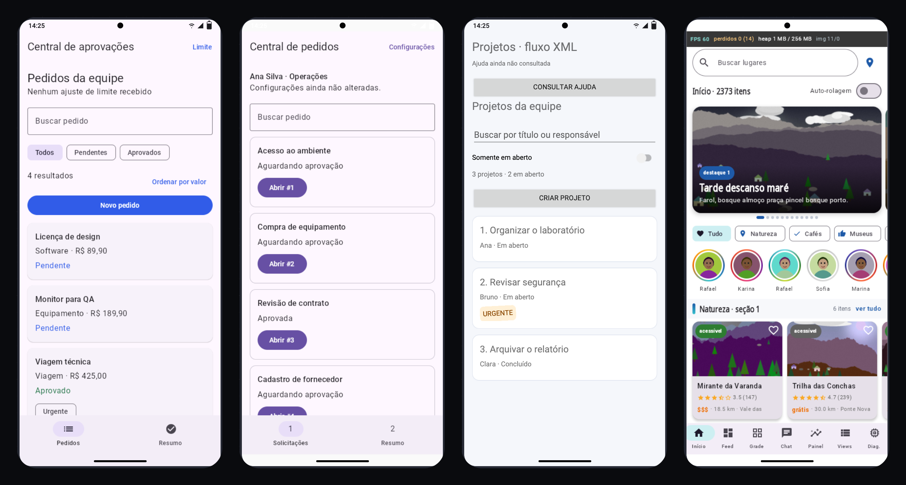
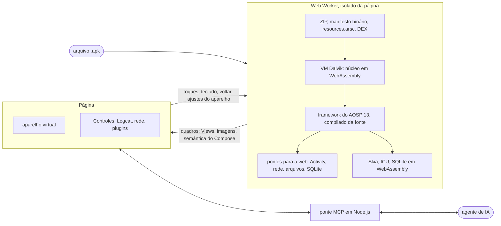

# APK Browser Lab

**Rode um APK Android dentro de uma aba do navegador.** Sem emulador, sem instalar nada, sem enviar o arquivo para lugar nenhum: o `.apk` é aberto na própria página, o código dele roda numa máquina virtual feita para a web, e a tela do app aparece ali, respondendo ao seu toque.

### [▶ Abrir o laboratório](https://madmax-dev-br.github.io/apk-browser-lab-site/)

[](https://madmax-dev-br.github.io/apk-browser-lab-site/)

<sub>Um app Jetpack Compose (Material 3) rodando na página: toques de verdade, teclado de verdade, nada pré-gravado pelo app.</sub>

## Por que isso é interessante

- **O APK roda como está.** Não é recompilado e não precisa do código-fonte. O bytecode DEX que está no arquivo é o que executa.
- **O Android por baixo é o original.** O framework é o código do AOSP 13 compilado da fonte; Skia, ICU e SQLite rodam em WebAssembly. A meta é o comportamento de um aparelho, não uma imitação.
- **Tudo acontece no seu navegador.** Não há servidor de execução. O arquivo não sai da sua máquina.
- **Quando falta algo, o lab diz o quê.** Uma API do Android que ainda não existe aqui falha com o nome exato dela, em vez de fingir que funcionou.
- **Dá para automatizar.** Plugins em JavaScript leem o app por dentro, e um agente de IA (Claude Code, Cursor, Codex) dirige a página por MCP, inclusive com os comandos `adb` que você já usa num emulador.

## Experimente em um minuto

1. Abra **<https://madmax-dev-br.github.io/apk-browser-lab-site/>** num navegador recente.
2. Arraste um `.apk` para a página (até 1 GiB).
3. O app é instalado na tela inicial do aparelho virtual e abre. Toque, digite, role, volte.

O site não traz APKs prontos: você usa o seu. Os apps das imagens desta página são os de exemplo do próprio projeto, feitos para testar o laboratório.



## O que já roda

Interfaces em Jetpack Compose e em Views/XML, Fragments, navegação entre telas e entre Activities, listas longas com imagens, formulários, diálogos, SharedPreferences, SQLite, rede sobre `fetch`, threads, `Handler`/`Looper` e corrotinas.



<sub>Apps de exemplo do projeto: Compose com estado, Navigation Compose, Views com Fragments e uma lista pesada com imagens.</sub>

## O que dá para fazer com ele

### Um aparelho que você controla

Tamanho de tela, orientação, tema claro ou escuro, idioma e região, fuso, escala de fonte, bateria e rede (online, dados móveis, offline). As permissões de execução do app são suas para conceder ou negar, e os links profundos abrem como num `am start`.

### Ver o app por dentro

- **Logcat** e **log de rede** ao vivo, com cada requisição do app.
- **Mock de endpoints**: faça `/v1/perfil` devolver o que você quiser, sem tocar no servidor.
- **Redirecionar hosts**: aponte a API do app para o seu `localhost`.
- **Dados do app**: SharedPreferences e bancos SQLite, para ler e editar.
- **Limites de layout** e a **árvore do Compose**, com os CompositionLocals de cada composable.
- **Diagnóstico** quando algo para: a causa, a pilha Java e as APIs que faltaram.

### Plugins

Pequenos scripts em JavaScript que rodam ao lado do app e leem a tela, a árvore do Compose, os ViewModels e o estado estático, tiram prints de um componente, rolam listas e desenham por cima do aparelho. Há [exemplos prontos para copiar](https://madmax-dev-br.github.io/apk-browser-lab-site/plugins.html#exemplos).


### Agentes de IA, por MCP

Uma ponte pequena em Node.js liga a página aberta a um cliente MCP. O agente tira prints, toca, digita, lê o Logcat e a rede, instala e abre apps, grava a tela em vídeo, e aceita linhas de comando do `adb`:

```sh
adb install -r app-debug.apk
adb shell am start -W -n com.exemplo.app/.MainActivity
adb shell input tap 200 400 && adb shell input text ola%smundo
adb exec-out screencap -p > tela.png
adb exec-out uiautomator dump /dev/tty
adb logcat -d *:E | grep -i timeout
```

Não é o adb: é um interpretador que faz na página o que cada comando faz num aparelho, e que recusa pelo nome o que a página não alcança. A página mostra o comando para iniciar a ponte e o endereço para o agente em **Controles › MCP**. Detalhes em [MCP: o agente usando a página](https://madmax-dev-br.github.io/apk-browser-lab-site/plugins.html#mcp).

### Incorporar em outra página

O aparelho virtual também funciona como um player dentro de um `iframe`, comandado por mensagens. Veja a [página de integração](https://madmax-dev-br.github.io/apk-browser-lab-site/player/example.html).

## Como funciona



- O APK é lido num **Web Worker**: ZIP, manifesto, recursos e DEX, sem passar pela página.
- O bytecode roda numa **VM Dalvik** cujo núcleo é WebAssembly. Threads, relógio, coletor de lixo e limite de memória são modelados.
- As classes `android.*` vêm do **AOSP 13 compilado da fonte**, com as adaptações registradas. As fronteiras com o mundo (janela, rede, arquivos, banco) são pontes para APIs da web.
- O **Compose** desenha com o Skia de verdade, em WebAssembly, e recebe toques como eventos `MotionEvent` reais.
- A página só mostra os quadros e envia a entrada. O que o app faz é decidido pelo código do app.

A explicação completa, passo a passo, está na página [Arquitetura](https://madmax-dev-br.github.io/apk-browser-lab-site/arquitetura.html).

## Limites, sem enfeite

Isto não é um emulador Android. Não há kernel, hardware nem Play Store.

- **Bibliotecas nativas** (`.so`) só rodam quando existe uma versão em WebAssembly compilada de fonte pública. As demais viram falha explícita. Bibliotecas de proteção do app nunca são substituídas nem contornadas.
- **Serviços do Google**: por padrão o aparelho não tem. Há uma opção de dispositivo com microG, sem login de conta, sem push e sem Play Integrity.
- **Apps grandes** exercitam muito mais do Android do que os exemplos. Cada um revela APIs que ainda faltam, e o lab mostra quais.
- **Desempenho** é menor que o de um aparelho.
- O selo do topo da página é honesto: **Experimental**.

## Privacidade

O APK é lido e executado no seu navegador. Nada é enviado a um servidor do laboratório, porque não existe um. A rede do app sai pelo próprio navegador, só para os hosts que você permitir. Os apps que você abre ficam guardados neste navegador (IndexedDB), para reabrir pelo ícone, e você pode removê-los.

## Links

| | |
|---|---|
| [Laboratório](https://madmax-dev-br.github.io/apk-browser-lab-site/) | Abrir e rodar um APK |
| [Arquitetura](https://madmax-dev-br.github.io/apk-browser-lab-site/arquitetura.html) | Do arquivo à tela, por dentro |
| [Plugins](https://madmax-dev-br.github.io/apk-browser-lab-site/plugins.html) | A API `lab.*` e exemplos prontos |
| [MCP](https://madmax-dev-br.github.io/apk-browser-lab-site/plugins.html#mcp) | Ligar um agente de IA, comandos `adb`, gravar a tela |
| [Integração](https://madmax-dev-br.github.io/apk-browser-lab-site/player/example.html) | O aparelho virtual dentro da sua página |
| [Licenças de terceiros](THIRD_PARTY.md) | Avisos e licenças de bibliotecas incluídas no build (textos em [`licenses/`](licenses)) |

## Sobre este repositório

Este repositório guarda o build publicado, que é o que o GitHub Pages serve. Achou um app que não abre, ou uma API que falta? [Abra uma issue](https://github.com/madmax-dev-br/apk-browser-lab-site/issues) com o texto de **Copiar diagnóstico** da página. Ele traz a causa e as APIs que faltaram, e é o que mais ajuda a fechar a lacuna.
